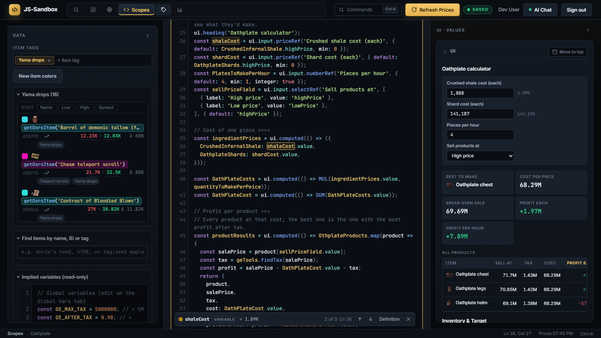
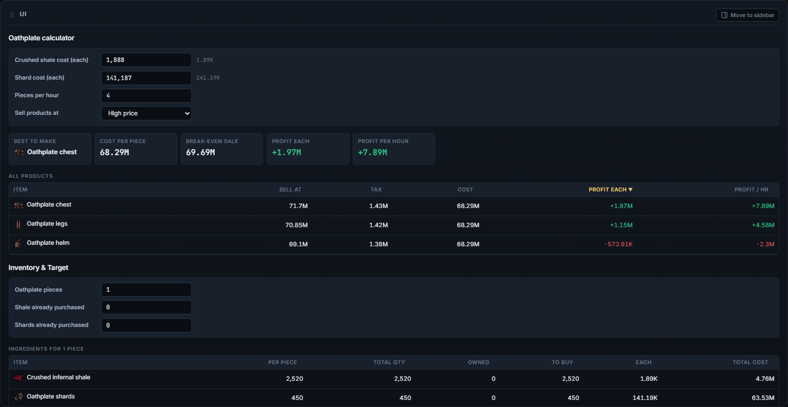
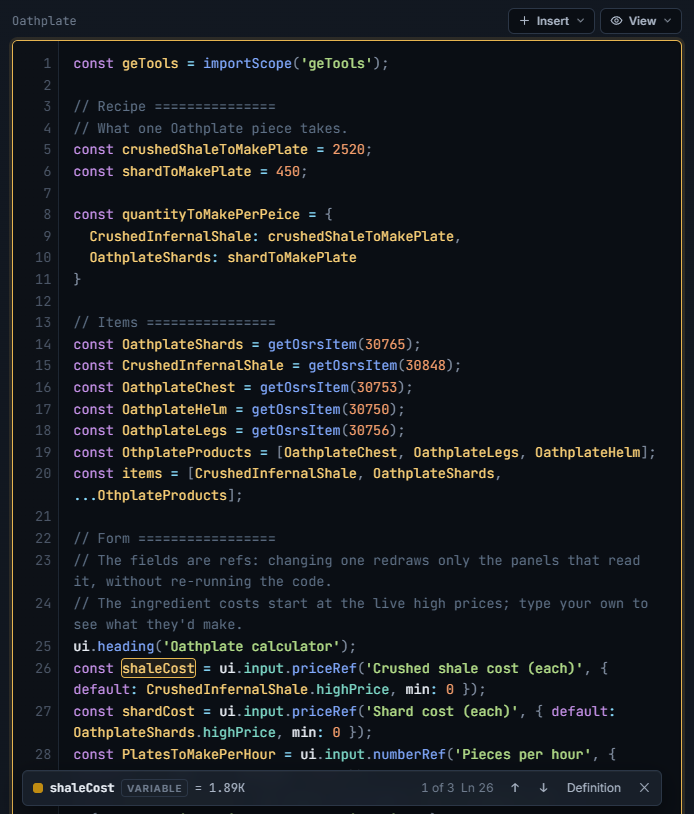
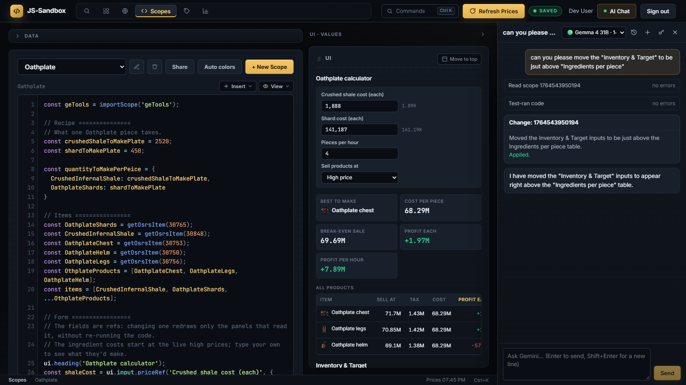

# GE Tracker · Price Computation Suite

A tool for tracking Old School RuneScape Grand Exchange prices and computing values with formulas.
Users sign in with Google; their scopes, globals, tags and settings are stored on the server, so
they follow them across devices. A scope can be shared read-only by link.

## Features

The screenshots below are all of one scope: an Oathplate armour profit calculator.

### Workbench

The Scopes tab is a work area: a Data panel for finding items, the code editor, and a sidebar
with the scope's UI and values. Panels resize by dragging the splitters between them and
collapse to a rail (Ctrl+B / Ctrl+Alt+B), and the UI section is dragged by its header to dock it
full width above the editor or in the sidebar. Ctrl+K opens a command palette.



### Scope UI

A scope's code can build its own UI: forms, stat tiles and tables that update as prices and
inputs change.



### Code editor

Each scope is JavaScript with built-in functions for looking up items and their live prices.
The editor highlights variables, and item lookups take their item tag's colour. With the caret
on a variable, its occurrences are marked and a bar at the bottom steps through them (F7 /
Shift+F7) or jumps to its declaration (F12).



### AI chat

The AI chat drawer can answer questions about items and prices, or change a scope. It reads the
scope, test-runs its edit, and changes nothing until you click Apply.



More in [docs/](docs/README.md).

## Running it

### With Docker (recommended)

```sh
cp .env.example .env        # local-development defaults; DEV_LOGIN=true lets you sign in without Google
docker compose up --build
```

Open http://localhost:3000. Data lives in the `ge-tracker-data` volume.

That runs the code baked into the image, so a change needs a rebuild. For development, add
`docker-compose.dev.yml`, which mounts `server/` and `public/` from the working folder:

```sh
docker compose -f docker-compose.yml -f docker-compose.dev.yml up -d --build
```

A server change then restarts the server within a second (`tools/dev-server.mjs`), and a browser
refresh picks up a `public/` change. Rebuild only after changing `package.json` or the `Dockerfile`.

### Without Docker

Needs Node 20 or later.

```sh
cp .env.example .env
npm install
npm run dev                 # restarts on changes; reads .env
```

Data goes in `storage/` (git-ignored).

## Production (VPS with Traefik)

1. Point your domain's DNS at the server and open ports 80 and 443.
2. In `.env`, set:
   - `DOMAIN` and `ACME_EMAIL` (for the Let's Encrypt certificate)
   - `SESSION_SECRET` to a long random string: `node -e "console.log(require('crypto').randomBytes(48).toString('base64url'))"`
   - `GOOGLE_CLIENT_ID` and `GOOGLE_CLIENT_SECRET` (below)
   - `AI_KEY_SECRET` to another long random string, so users can connect their own Anthropic API
     key to use Claude (it encrypts the stored keys). Leave it empty to turn Claude off.
3. Start the app and Traefik:

   ```sh
   docker compose -f docker-compose.yml -f docker-compose.prod.yml up -d --build
   ```

   The production override sets `NODE_ENV=production` (which turns the dev sign-in off) and
   `BASE_URL=https://$DOMAIN`.

### Google sign-in

In [Google Cloud Console](https://console.cloud.google.com/apis/credentials), create an
**OAuth client ID** of type **Web application** and add these **Authorized redirect URIs**:

- `http://localhost:3000/auth/google/callback` (development)
- `https://<your DOMAIN>/auth/google/callback` (production)

Copy the client ID and secret into `.env`. The OAuth consent screen needs the `email` and
`profile` scopes.

## How it's built

```
server/
  index.js          start: run migrations, then listen
  app.js            Express: security headers, sessions, routes, static files
  config.js         settings from the environment (.env.example documents them)
  db/               Knex + SQLite (better-sqlite3); migrations/ holds the schema
  auth/             Google sign-in (Passport) and the SQLite session store
  routes/           URL -> middleware -> controller
  controllers/      HTTP in and out
  managers/         the work: reading and writing the database, icons, sharing
  middleware/       sign-in check, API header check, validation, errors
  validation/       zod schemas for request bodies
public/             the browser app (Vue 3 from a CDN, no build step)
test/               vitest + supertest; test/browser runs the browser store against a real server
tools/              scripts that rebuild public/data/ from the OSRS wiki
```

- **Saving.** The browser saves each changed record (a scope, an item tag, ...) about a second
  after edits pause. Every record has a version; a save from a tab that loaded an older version is
  refused (409), and the tab offers to reload or keep its own version.
- **Icons.** `/icons/<name>` downloads each item icon from the OSRS wiki once and serves it from
  the data volume afterwards.
- **Prices.** Still fetched by the browser straight from the OSRS wiki's prices API.
- **AI chat (Claude and Gemini).** Each user connects their own Anthropic and/or Google Gemini API
  key (the **AI Chat** button in the header), stored encrypted with `AI_KEY_SECRET`, and picks a
  model in the chat drawer. The drawer sends the conversation to `/api/ai/chat`, which adds the
  system prompt and streams the reply back in one shape for both providers
  (`server/ai/anthropicChat.js`, `server/ai/geminiChat.js`). Conversations can switch provider
  midway: `server/ai/transcript.js` converts them. Rate limits (common on Gemini's free tier) are
  waited out and retried automatically. The system prompt
  is built at start-up from the formula files' header comments and `functions.js`'s docs
  (`server/ai/systemPrompt.js`), so document new scope functions there. The model's tools (item
  search, reading and test-running code, proposing edits) run in the browser
  (`public/js/ai/agentTools.js`; the server declares them in `server/ai/tools.js`). An edit only
  happens when the user clicks Apply. Chats are saved per user.

### Database migrations

The server applies pending migrations on start. To add one:

```sh
npm run migrate:make -- add_something     # creates server/db/migrations/<timestamp>_add_something.js
npm run migrate                           # apply now (the server also does this on start)
npm run migrate:rollback
```

Migrations are ES modules exporting `up(knex)` and `down(knex)`.

### Tests

```sh
npm test
```
